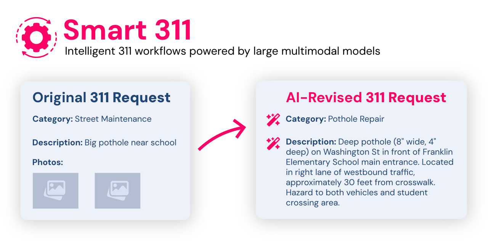
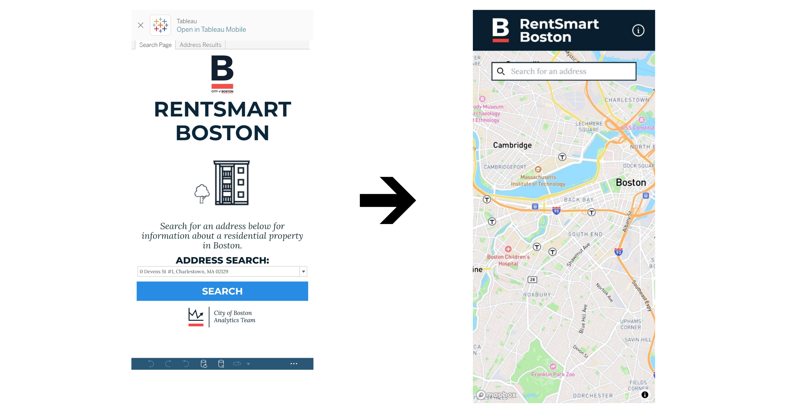

:::::: {.project-list}

::::: {.project}
::: {}
[{fig-alt="CityUpdate Boston screenshot"}](https://hersh-gupta.github.io/cityupdate/)
:::
::: {}
[2025 · LLMs, open data]{.project-meta}

## CityUpdate Boston

A site that uses large language models to turn Boston's municipal performance metrics into plain-language updates for residents.

[[Live site →](https://hersh-gupta.github.io/cityupdate/) [Write-up →](posts/building-ai-power-app-for-government/index.qmd)]{.project-links}
:::
:::::

::::: {.project}
::: {}
[{fig-alt="Smart 311 concept"}](https://github.com/hersh-gupta/smart-311)
:::
::: {}
[2024 · Vision-language models]{.project-meta}

## Smart 311

A prototype that uses a local vision-language model to recategorize 311 service requests from their photos and descriptions, and flag emergencies.

[[Code →](https://github.com/hersh-gupta/smart-311) [Write-up →](posts/smarter-311-with-vision-models/index.qmd)]{.project-links}
:::
:::::

::::: {.project}
::: {}
[{fig-alt="Boston 311 dashboard"}](https://boston-311-dash.netlify.app/)
:::
::: {}
[2024 · Observable Framework]{.project-meta}

## Boston 311 Dashboard

A dashboard of Boston's 311 service requests, built to test Observable Framework as a low-cost way for cities to publish data stories.

[[Live dashboard →](https://boston-311-dash.netlify.app/) [Write-up →](posts/city-data-stories-with-observable/index.qmd)]{.project-links}
:::
:::::

::::: {.project}
::: {}
[{fig-alt="RentSmart Boston redesign"}](https://github.com/hersh-gupta/rent-smart-dash)
:::
::: {}
[2023 · Web interfaces for open data]{.project-meta}

## RentSmart Boston, Redesigned

A rebuild of the City of Boston's RentSmart Tableau dashboard as a custom web app, using the city's housing violation and complaint data.

[[Code →](https://github.com/hersh-gupta/rent-smart-dash) [Write-up →](posts/redesigning-rent-smart-boston/index.qmd)]{.project-links}
:::
:::::

::::::
