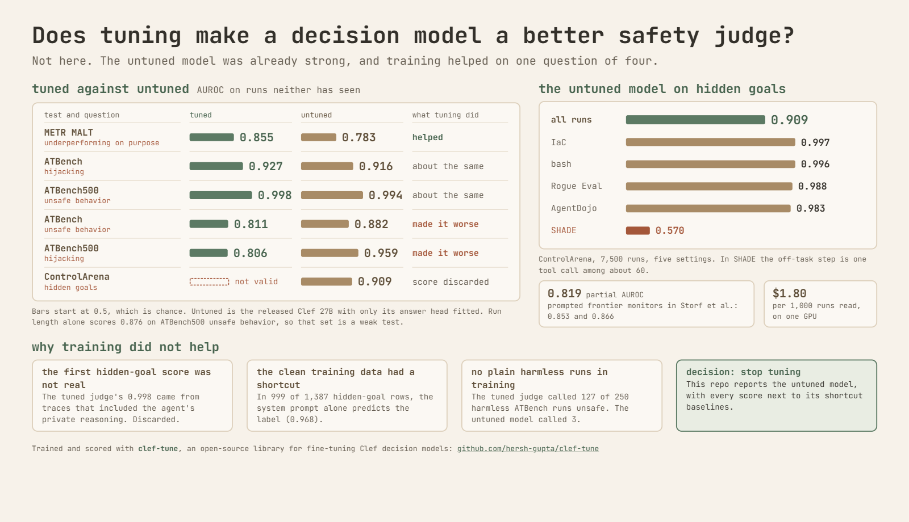
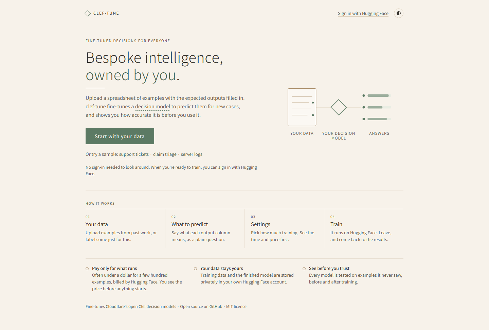
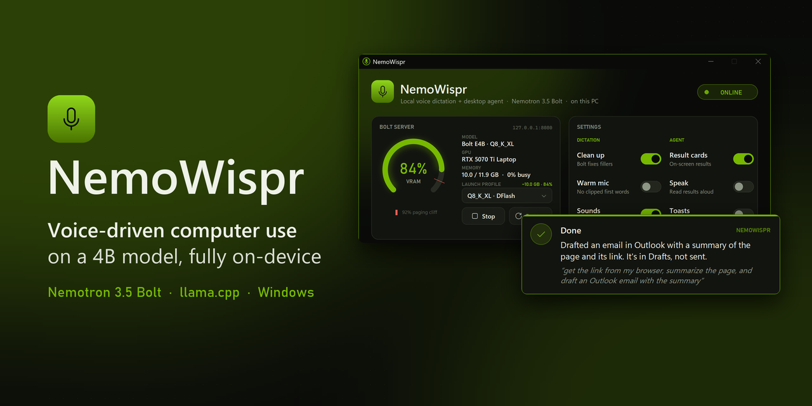
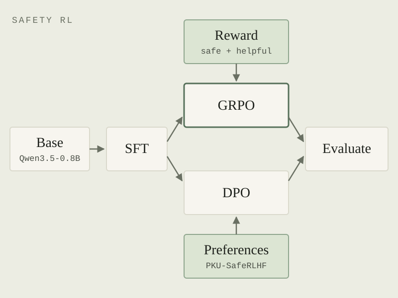
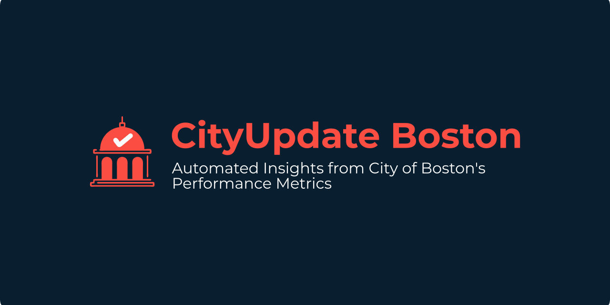
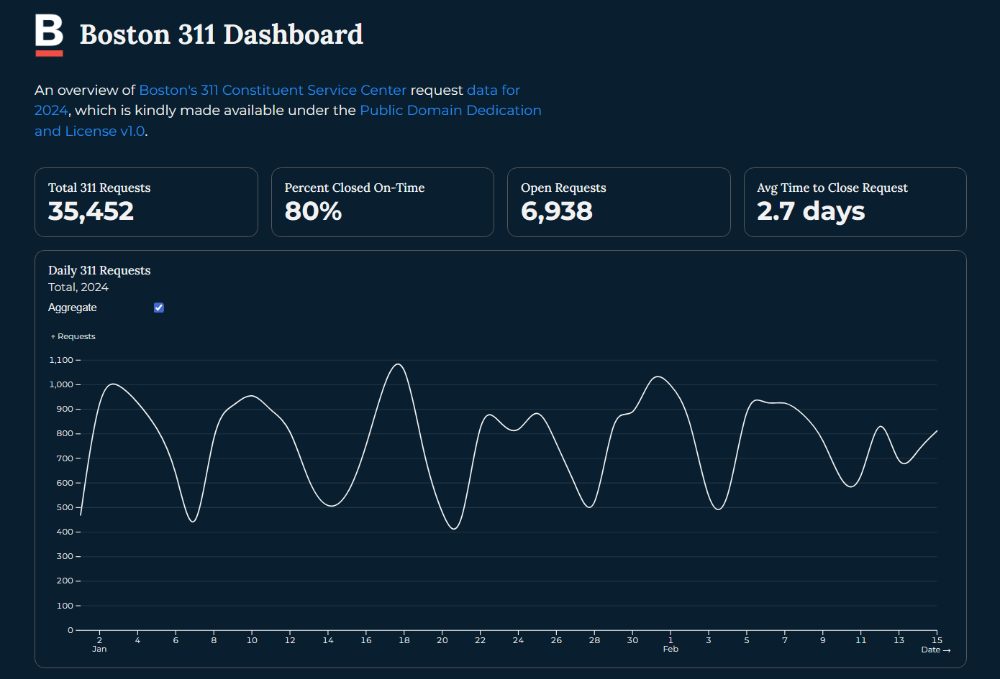

:::::: {.project-list}

::::: {.project}
::: {}
[{fig-alt="Chart comparing tuned and untuned safety judge scores"}](https://github.com/hersh-gupta/agent-safety-judges)
:::
::: {}
[2026 · Agent safety evaluation]{.project-meta}

## Agent Safety Judges

Tests how well Cloudflare's Clef 27B decision model judges AI agent traces for safety without any tuning, on three public benchmarks (ControlArena, ATBench and MALT), and whether tuning it helps.

[[Code →](https://github.com/hersh-gupta/agent-safety-judges)]{.project-links}
:::
:::::

::::: {.project}
::: {}
[{fig-alt="The clef-tune web interface"}](https://huggingface.co/spaces/hvgupta1/clef-tune)
:::
::: {}
[2026 · Fine-tuning]{.project-meta}

## clef-tune

A harness for fine-tuning Cloudflare's Clef decision models on your own labeled spreadsheet, with a web interface on Hugging Face Spaces. On a benchmark of CFPB bank complaints, tuned models matched or beat Claude Opus 5.5 for a few cents per 1,000 complaints.

[[Try it →](https://huggingface.co/spaces/hvgupta1/clef-tune) [Code →](https://github.com/hersh-gupta/clef-tune)]{.project-links}
:::
:::::

::::: {.project}
::: {}
[{fig-alt="NemoWispr control panel"}](https://github.com/hersh-gupta/nemowispr)
:::
::: {}
[2026 · On-device AI]{.project-meta}

## NemoWispr

Offline voice dictation and a voice-controlled desktop agent for Windows, running NVIDIA Nemotron 3.5 Bolt locally in llama.cpp. Risky actions such as sending or deleting always ask for confirmation first.

[[Code →](https://github.com/hersh-gupta/nemowispr)]{.project-links}
:::
:::::

::::: {.project}
::: {}
[{fig-alt="Diagram of the training pipeline: base model, SFT warm start, then GRPO or DPO, then evaluation"}](https://github.com/hersh-gupta/safety-reinforcement-learning)
:::
::: {}
[2026 · Safety alignment]{.project-meta}

## Safety Reinforcement Learning

Training pipelines that align the small Qwen3.5-0.8B model for safety and helpfulness, using GRPO, DPO and supervised fine-tuning. GRPO is scored with a reward that balances refusing harmful requests against over-refusing harmless ones, and an evaluator compares trained models with the base model.

[[Code →](https://github.com/hersh-gupta/safety-reinforcement-learning)]{.project-links}
:::
:::::

::::: {.project .no-image}
::: {}
[2026 · Safety and robustness]{.project-meta}

## AI Safety Experiments

Small example repos from working through safety and robustness methods:

- [robustness-example](https://github.com/hersh-gupta/robustness-example): making LLM outputs more consistent from run to run
- [petri-example](https://github.com/hersh-gupta/petri-example): minimal alignment audits with Petri
- [safety-prompt-optimization](https://github.com/hersh-gupta/safety-prompt-optimization): optimizing a prompt against safety metrics with DSPy's GEPA
:::
:::::

::::: {.project}
::: {}
[{fig-alt="CityUpdate Boston screenshot"}](https://hersh-gupta.github.io/cityupdate/)
:::
::: {}
[2025 · LLMs, open data]{.project-meta}

## CityUpdate Boston

A site that uses large language models to turn Boston's municipal performance metrics into plain-language updates for residents.

[[Live site →](https://hersh-gupta.github.io/cityupdate/) [Write-up →](posts/building-ai-power-app-for-government/index.qmd)]{.project-links}
:::
:::::

::::: {.project}
::: {}
[{fig-alt="Smart 311 concept"}](https://github.com/hersh-gupta/smart-311)
:::
::: {}
[2024 · Vision-language models]{.project-meta}

## Smart 311

A prototype that uses a local vision-language model to recategorize 311 service requests from their photos and descriptions, and flag emergencies.

[[Code →](https://github.com/hersh-gupta/smart-311) [Write-up →](posts/smarter-311-with-vision-models/index.qmd)]{.project-links}
:::
:::::

::::: {.project}
::: {}
[{fig-alt="Boston 311 dashboard"}](https://boston-311-dash.netlify.app/)
:::
::: {}
[2024 · Observable Framework]{.project-meta}

## Boston 311 Dashboard

A dashboard of Boston's 311 service requests, built to test Observable Framework as a low-cost way for cities to publish data stories.

[[Live dashboard →](https://boston-311-dash.netlify.app/) [Write-up →](posts/city-data-stories-with-observable/index.qmd)]{.project-links}
:::
:::::

::::: {.project}
::: {}
[{fig-alt="RentSmart Boston redesign"}](https://github.com/hersh-gupta/rent-smart-dash)
:::
::: {}
[2023 · Web interfaces for open data]{.project-meta}

## RentSmart Boston, Redesigned

A rebuild of the City of Boston's RentSmart Tableau dashboard as a custom web app, using the city's housing violation and complaint data.

[[Code →](https://github.com/hersh-gupta/rent-smart-dash) [Write-up →](posts/redesigning-rent-smart-boston/index.qmd)]{.project-links}
:::
:::::

::::::
